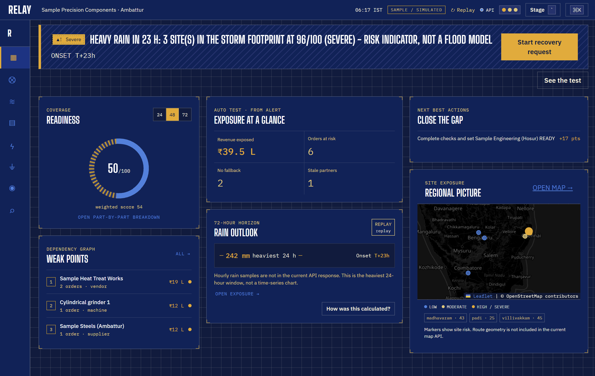
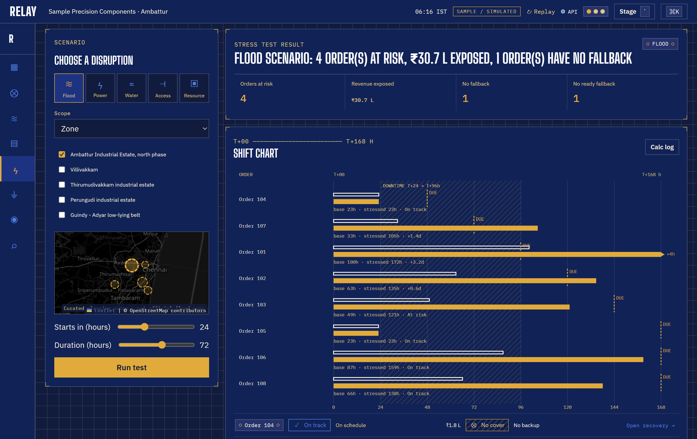
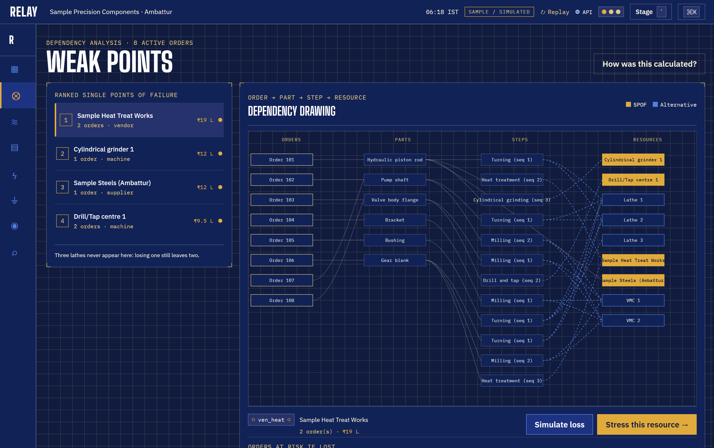

# RELAY — Factory Continuity Desk

**Find where your factory breaks before the flood does, then show who can cover it.**

RELAY is a production-continuity desk for small precision-component manufacturers. It reads an
engineering drawing, traces which machines, vendors and materials each order actually depends on,
scores how exposed those sites are to a storm, and shows which backup factories could take the
work — flagging the ones standing in the same water.

Built for the **Vihaan X** hackathon, Open Innovation track.

> **Live demo:** <https://project-relay-nu.vercel.app>
> **API docs:** <https://relay-api-l6df.onrender.com/docs> · **Health:** <https://relay-api-l6df.onrender.com/api/v1/health>
>
> Both run on free tiers, so the first request after a quiet period can take ~30 s
> (press **Retry** if you see "Can't reach the server"). The whole app also runs
> read-only from a committed replay pack — click **Open saved snapshot** and it works
> with the backend switched off.

---

## Screenshots

| Desk — the morning view | What-if — stress a disruption | Weak points — where it breaks |
|---|---|---|
|  |  |  |

More in [`docs/screens/final/`](docs/screens/final/).

---

## What it does

The product leads with **diagnosis**, not with a marketplace. Matching is the last step, and it
knows about correlated risk.

| # | Module | What it answers |
|---|---|---|
| M1 | Catalogue & relationships | What do we make, on which machines, with which vendors and materials? |
| M2 | Production Passport & RFQ | Read the drawing; produce a structured part record and a redacted RFQ a partner can quote on |
| M3 | Weak points (SPOF) | Remove one resource — which orders break with no alternative? |
| M4 | Exposure | How exposed is each site to this storm window, and why? |
| M5 | Stress test | What happens to the schedule under a hazard, scope and duration? |
| M6 | Matching | Which capable partners could cover the work, and which are excluded for correlated risk? |
| M7 | Recovery request | Turn an at-risk order into a prefilled recovery request |
| M8 | Readiness | What share of critical production has a viable fallback, in a 24/48/72 h window? |
| M9 | Handover pack | The consent-aware pack a backup factory receives |
| M10 | Tracking | A simulated milestone route card for the recovery |

**The closing moment:** complete a partner's outstanding checks → set **READY** → the weighted
readiness score rises (53.9 → 70.9 in the sample world) and the relay circuit closes.

### Presenter mode

The 8-step demo runs from the keyboard: `→`/`←` step, `R` reset, `H` hide the strip,
`` ` `` Stage Controls, `/` or `⌘K` the command palette, `1`–`8` jump to a screen.

---

## How it works

```
React + Vite SPA  ──HTTP/JSON──▶  FastAPI  ──▶  deterministic core (pure functions)
   landing + 8 screens                 │                    │
   lazy 3D hero (three/R3F)            │                    └── exposure, SPOF, stress,
   offline snapshot fallback           │                        matching, readiness maths
                                       ├── SQLite (sample world)
                                       └── adapters: weather (Open-Meteo), vision (Gemini, optional)
```

- **Deterministic maths, explainable numbers.** Exposure, SPOF, matching and readiness are pure
  functions over the data; every screen has a *"How was this calculated?"* trace. No LLM is in the
  scoring path.
- **AI reads drawings only.** Vision extraction is cross-checked against a deterministic
  text-rules parser; disagreements and low-confidence fields go to a person, and nothing is saved
  as confirmed without human review. The manual path works with the reading service switched off.
- **Runs without any API key.** Weather is a replay of real Cyclone Michaung rainfall (Dec 2023)
  time-shifted to now, and sample drawings are answered from a committed golden cache.

---

## Quickstart (Windows, from the repo root)

```powershell
# 1. backend - seed the sample world, then serve
cd backend
.\.venv\Scripts\python.exe scripts\reset_demo.py
.\.venv\Scripts\python.exe -m uvicorn app.main:app --reload --port 8000

# 2. frontend (second terminal)
cd ..\frontend
npm install
npm run dev
```

- UI: <http://localhost:5173> · API docs: <http://localhost:8000/docs>
- Landing static fallback (no 3D): <http://localhost:5173/?tier=static>

Backend setup and environment variables: [`backend/README.md`](backend/README.md).
Frontend scripts, shortcuts and scene tiers: [`frontend/README.md`](frontend/README.md).

---

## Tests and quality

| Suite | Result |
|---|---|
| Backend (`pytest`) | 271 passing, 1 optional live test deselected; `ruff` clean |
| Coverage | `app/core` 94%, `app/services` 90% |
| Frontend (`npm test`) | 16 passing |
| Lint | `oxlint` clean, palette lint clean, production build clean |
| Lighthouse | Landing and Desk: 100 accessibility / 100 best practices / 100 SEO |

The Phase 14 end-to-end gate — replay story, contract, failure injection, determinism, concurrency,
privacy and zero-key runs — is recorded in [`docs/TEST_REPORT.md`](docs/TEST_REPORT.md).

---

## Deploy

Frontend on Vercel, backend on Render or Railway (FastAPI + SQLite needs a writable disk).
Step-by-step, including the free-tier caveats: [`docs/DEPLOY.md`](docs/DEPLOY.md).

---

## Repository layout

```
backend/     FastAPI app, deterministic core, adapters, config, seeded sample world, tests
frontend/    React + Vite SPA: landing story, 8 screens, component library, offline snapshot
docs/        project brief, technical blueprint, frontend planner, progress, test report, deploy guide
render.yaml  Render blueprint for the backend
vercel.json  Vercel build config for the frontend
```

## Documentation

| Doc | What's in it |
|---|---|
| [`docs/01_PROJECT_BRIEF.md`](docs/01_PROJECT_BRIEF.md) | The problem, the pitch and the scope |
| [`docs/02_TECHNICAL_BLUEPRINT.md`](docs/02_TECHNICAL_BLUEPRINT.md) | Architecture, data model, module contracts, risks, Q&A prep |
| [`docs/03_FRONTEND_PLANNER.md`](docs/03_FRONTEND_PLANNER.md) | Screens, components, interaction spec and phases |
| [`docs/PROGRESS.md`](docs/PROGRESS.md) | Phase-by-phase log, decisions and what was deliberately cut |
| [`docs/TEST_REPORT.md`](docs/TEST_REPORT.md) | The end-to-end test gate and its evidence |
| [`docs/BACKTEST_EXPOSURE.md`](docs/BACKTEST_EXPOSURE.md) | The Cyclone Michaung back-test |
| [`docs/VERIFIED_FACTS.md`](docs/VERIFIED_FACTS.md) | Externally checked data and API facts |
| [`docs/DEPLOY.md`](docs/DEPLOY.md) | Hosting steps and caveats |
| [`docs/openapi.snapshot.json`](docs/openapi.snapshot.json) | Committed API contract snapshot |

---

## Limitations (stated honestly)

- **Risk is an indicator, not a prediction.** Exposure scores come from forecast rain and site
  conditions; they are not a flood model and not flood probabilities.
- **Matches are candidates, not approved backups.** Activation stays subject to human, customer and
  contractual approvals outside the software.
- **A distant backup is not automatically a safe one.** Shared hazard zone, cluster and grid
  conditions are checked explicitly and can exclude a partner.
- **All factories, orders, people and drawings in the demo are fictional samples.** Weather,
  elevation and road data are real.
- **Live provider paths were not exercised for this submission.** The demo runs on replay weather
  and a committed golden drawing cache; the live forecast and live vision paths exist but were left
  switched off so nothing depends on a key on stage.
- **This is a prototype.** Single-process SQLite, no authentication, no migrations, no rate
  limiting.

## Attributions

- Weather data by [Open-Meteo.com](https://open-meteo.com)
- Map data © [OpenStreetMap](https://www.openstreetmap.org) contributors
- Flood labels summarised from public reporting (KNN India, The Hindu, The Week, The Hindu
  BusinessLine, Deccan Herald) — see the back-test report for citations
- Fonts via [`@fontsource`](https://fontsource.org) (self-hosted, offline)
